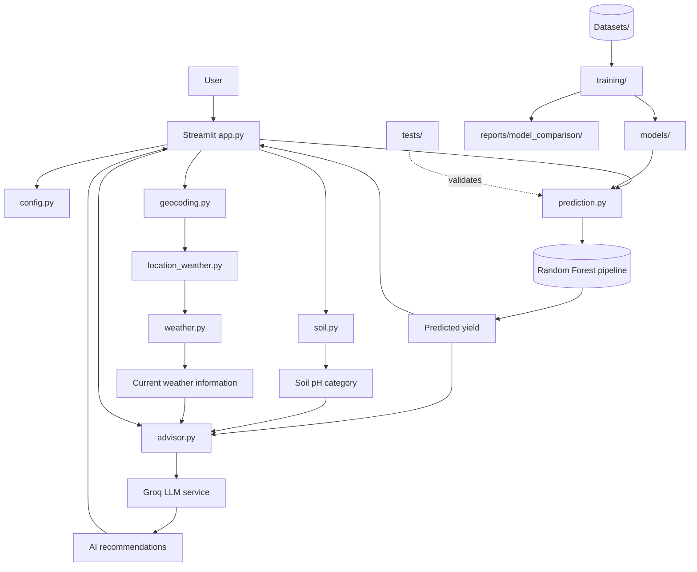

# Kishan Mitra — System Architecture

## 1. Overview

Kishan Mitra is a Streamlit-based agricultural decision-support application. It combines a saved crop-yield regression pipeline with location and weather services, soil pH analysis, and an LLM-powered AI Advisor.

The application is organized into three main areas:

1. **Application layer:** Streamlit interface and workflow coordination.
2. **Service and prediction layer:** model inference, soil analysis, geocoding, weather retrieval, and AI advice.
3. **Data and experimentation layer:** historical dataset, serialized model artifacts, training scripts, tests, and evaluation reports.

The production inference path uses the existing Random Forest pipeline. Experimental candidate models are maintained separately and are not automatically selected by the application.

## 2. High-Level Architecture

This diagram represents the logical flow. Exact call order and error handling depend on the current implementation of each module.

## 3. Repository Responsibilities

### 3.1 Application entry point

**File:** `app.py`

Responsibilities:

- Render the user interface using Streamlit.
- Collect crop, location, soil, and environmental inputs.
- Coordinate calls to prediction and service modules.
- Display predicted yield and relevant contextual information.
- Present AI Advisor recommendations.
- Communicate errors or unavailable external information to the user.

The entry point should coordinate the workflow rather than duplicate model-training or service-implementation logic.

### 3.2 Source package

**Directory:** `src/kishan_mitra/`

| Module | Responsibility |
|---|---|
| `config.py` | Central configuration, project paths, and model-related settings |
| `prediction.py` | Load the saved pipeline, prepare inputs, select the configured model, and generate predictions |
| `weather.py` | Retrieve and parse current weather data |
| `geocoding.py` | Convert a place name into geographic coordinates |
| `location_weather.py` | Coordinate location and weather-related operations |
| `soil.py` | Analyze the supplied soil pH and determine its descriptive category |
| `advisor.py` | Prepare the AI Advisor request and process the LLM response |
| `logging_config.py` | Configure application logging |
| `__init__.py` | Mark the source directory as a Python package |

The exact responsibilities should remain aligned with the implementation. Changes to module interfaces should be reflected in the application and tests.

### 3.3 Dataset and validation

**Directory:** `Datasets/`

The principal dataset is:

`Custom_Crops_yield_Historical_Dataset.csv`

The `data/` directory contains dataset validation utilities and documentation. Dataset checks should identify malformed values, missing required fields, invalid target values, and schema changes before training.

The recorded validation report contained 50,765 rows and 20 columns. That count describes the dataset at the time it was validated; it should be refreshed if the source data changes.

### 3.4 Model artifacts

**Directory:** `models/`

| Artifact | Purpose |
|---|---|
| `crop_yield_pipeline.joblib` | Existing Random Forest production pipeline |
| `model_metadata.json` | Metadata associated with the existing pipeline |
| `crop_yield_extratrees_candidate.joblib` | Experimental Extra Trees candidate |
| `crop_yield_extratrees_candidate_metadata.json` | Metadata associated with the candidate |

The prediction module should load the intended artifact through centralized configuration. The application must not assume that every candidate artifact is available in every deployment environment.

Serialized model artifacts should be loaded only from trusted sources and with compatible library versions.

### 3.5 Training and experimentation

**Directory:** `training/`

This directory contains scripts for:

- Dataset audits and distribution analysis.
- Feature-leakage checks.
- Baseline and model comparisons.
- Model training.
- Validation and held-out test evaluation.
- Hyperparameter tuning.
- Investigation of extreme yield values.
- Candidate model verification.

The training workflow should be reproducible. Preprocessing must be fitted using training data only, and validation/test data must not influence fitting or hyperparameter selection.

### 3.6 Evaluation reports

**Directory:** `reports/model_comparison/`

This directory stores experiment logs, model-level metrics, crop-level comparisons, tuning results, and prediction-level evaluation files.

Reports should record the dataset version or fingerprint, split definition, random seed where applicable, feature configuration, model parameters, and dependency versions.

Metrics from different evaluation splits must not be treated as directly interchangeable.

### 3.7 Tests

**Directory:** `tests/`

The current test suite includes `test_prediction.py`.

Tests should cover model loading, input validation, prediction output, expected feature handling, and relevant error conditions. Service and LLM tests should use mocked external calls so that routine tests do not depend on network availability or consume API credits.

## 4. End-to-End Data Flow

### Step 1 — User input

The user enters the information requested by the Streamlit interface, such as crop, state, district, soil pH, and environmental inputs.

### Step 2 — Soil analysis

The soil module interprets the provided pH value and returns a descriptive category. A pH category is not a complete soil-fertility assessment.

### Step 3 — Location and weather retrieval

The application resolves the selected location into coordinates and retrieves current weather information through its configured service integrations.

These are external dependencies. Invalid locations, network failures, API limits, or missing credentials can prevent weather information from being retrieved.

### Step 4 — Yield prediction

The prediction module prepares the input features expected by the saved pipeline, loads the configured production artifact, and generates a numerical estimate in kg/ha.

The prediction must use the same preprocessing transformations and feature schema that were used during model training.

### Step 5 — AI Advisor

The AI Advisor receives the relevant prediction and available contextual information and sends a request to the configured LLM provider.

The generated advice is a separate AI output, not a verified consequence of the regression model. The Advisor should not imply that recommendations guarantee a yield increase.

### Step 6 — Results

The interface displays the available prediction, weather or soil information, and AI-generated recommendations. Missing external information should be handled transparently rather than represented as valid data.

## 5. Configuration and Secrets

The application uses environment configuration for external service credentials, including:

- `WEATHER_API_KEY`
- `GROQ_API_KEY`

For local development, credentials belong in a local `.env` file that is excluded from version control. In Streamlit Community Cloud, credentials should be configured through the application's Secrets settings.

Secrets must not be hard-coded or written to logs.

## 6. Model Selection and Promotion

The deployed interface currently selects `random_forest` explicitly.

The Extra Trees candidate showed a modest improvement in the recorded held-out test comparison, but a metric improvement alone is not sufficient for promotion.

A candidate must pass all of the following before replacing the production artifact:

1. Reproducible evaluation with documented splits.
2. Review of MAE, RMSE, R², and crop-level performance.
3. Input-schema and preprocessing compatibility checks.
4. Successful prediction tests.
5. End-to-end integration with the application.
6. Deployment verification, including artifact availability and resource usage.
7. An explicit and documented model-selection decision.

Until then, the existing Random Forest pipeline remains the production model.

## 7. Reliability and Failure Handling

The application depends on third-party APIs for some features. Expected failure cases include:

- Unknown or ambiguous locations.
- Geocoding rate limits, including HTTP 429.
- Weather service errors or timeouts.
- Missing or invalid API credentials.
- LLM service errors or unavailable models.
- Missing, incompatible, or corrupt model artifacts.
- Invalid or incomplete prediction inputs.

The application should provide useful error messages, avoid exposing credentials, and keep failures in optional integrations from causing misleading results.

External requests should use appropriate timeouts, response validation, and provider-compliant request rates. Cache stable location lookups where appropriate.

## 8. Reproducibility and Maintenance

For reproducible model development:

- Keep training and inference preprocessing consistent.
- Use documented training, validation, and test periods.
- Record model parameters and evaluation metrics.
- Pin critical dependencies, especially those used to deserialize saved models.
- Retain evaluation reports for model comparisons.
- Test model replacements before deployment.

The dataset, model artifacts, and evaluation reports should be versioned or tracked with a documented provenance strategy.

## 9. Current Scope and Known Limitations

- Weather retrieval represents current conditions, not necessarily the conditions throughout a crop's growing season.
- Geocoding and weather are dependent on external services and can fail independently of the ML model.
- Soil pH analysis does not replace laboratory soil testing.
- Predictions are limited by the training dataset, selected features, and historical relationships.
- The AI Advisor can generate incorrect or incomplete recommendations.
- Large serialized model artifacts may impose deployment storage and memory constraints.

Kishan Mitra is a decision-support prototype, not a substitute for agronomic expertise or a guarantee of agricultural outcomes.
